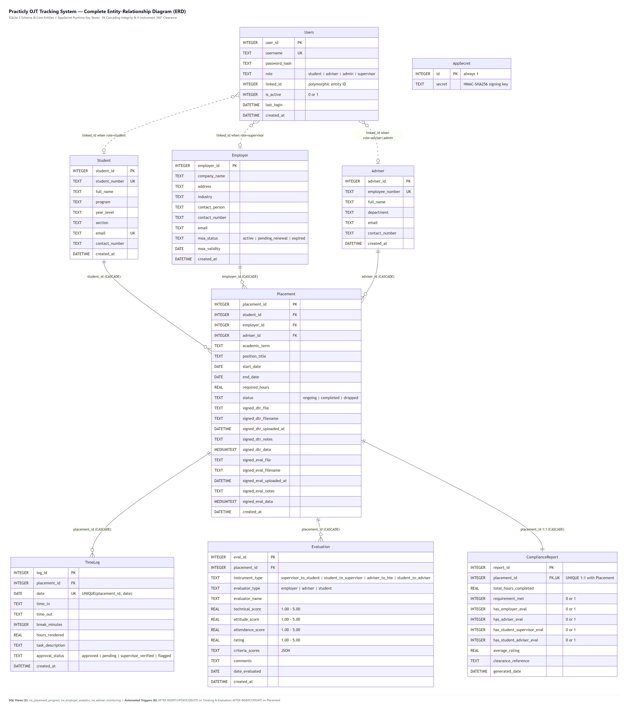

# Practicly — Internship / OJT Tracking & Employer Database System

**Metropolitan Institute of Technology (MIT)**  
*College of Engineering — Department of Computer Engineering (Sta. Mesa, Manila)*  
**Course:** Database Management System (BSCpE Software Development)  
**Live Deployment:** [https://practicly-portal.vercel.app](https://practicly-portal.vercel.app)

### Prepared by Group 8
| Member Name | Role | Primary Responsibilities |
| :--- | :--- | :--- |
| **Balanag, Kian H.** | Frontend Developer | Material Design 3 UI/UX, role-scoped workspaces, DTR/evaluation workflows, compliance & clearance views |
| **Calangian, Emmanuel G.** | Backend Developer | Normalized relational schema, SQL views/triggers, PHP REST API, RBAC & HMAC token security |
| **Gutierrez, Sophia Margarete N.** | Documentation Lead | System ERD specification, compliance & 4-instrument documentation, QA verification |
| **Yadao, Adrian E.** | Backend Developer | Hours aggregation (`SUM`), multi-table clearance eligibility triggers, HTE partner analytics |

---

## 1. System Overview & Architecture

**Practicly** centralizes student On-the-Job Training (OJT) placements, accredited Host Training Establishments (HTEs), Daily Time Records (DTRs), 360-degree evaluations, and clearance compliance reporting into a normalized relational database backed by a unified PHP REST API ([`backend/api/index.php`](backend/api/index.php)) and a Google Material Design 3 React (Vite) single-page application.

### Key Implemented Features
1. **Material Design 3 Interface & Clean Client Routing**:
   - Built with React 18, Vite 5, custom SVG iconography, `@fontsource/inter` & `@fontsource/open-runde`, dark/light theme tokens, Material 3 modals, segmented filters, filter chips, sliders, and responsive desktop/mobile navigation.
   - Clean path-based routing via [`src/utils/appRouter.js`](src/utils/appRouter.js) (`/dashboard`, `/timelogs`, `/evaluations`, `/compliance`, `/employers`, `/students`, `/adviser-monitoring`, `/placements`, `/admin`, `/database-erd`) with role-scoped guards and zero-login HTE verification links (`?verify=1`).
2. **4-Role Access Control + Zero-Login HTE Verification**:
   - **Student**, **HTE Supervisor**, **Faculty Adviser**, and **Coordinator (`admin`)** workspaces enforced server-side via HMAC-SHA256 stateless bearer tokens, bcrypt `Users.password_hash`, tenant-scoped queries, and `Cache-Control: no-store` headers.
   - Faculty Advisers and Coordinators can generate signed verification links so external HTE supervisors can verify shifts and submit rubrics (`?verify=1`) without needing a portal password.
3. **4-Stage DTR Pipeline & 360-Degree Evaluation Model**:
   - Supports daily shift tracking, Supervisor HTE verification, Faculty Adviser DTR audit & physical signed-DTR comparison, and Coordinator clearance sign-off.
   - Evaluates 4 instruments (`INST-01` Student -> HTE, `INST-02` Supervisor -> Student, `INST-03` Adviser -> HTE Audit, `INST-04` Student -> Adviser) plus weighted rubric scoring.
4. **Automated Relational Database Triggers & Views**:
   - Normalized 8 core tables (`Student`, `Employer`, `Adviser`, `Users`, `Placement`, `TimeLog`, `Evaluation`, `ComplianceReport`) plus runtime `AppSecret` key storage for HMAC signing.
   - Dual driver support in [`backend/config/database.php`](backend/config/database.php): portable **SQLite 3** (`database/ojt_tracking.db`, seeded via [`database/schema_and_seed_sqlite.sql`](database/schema_and_seed_sqlite.sql)) and **MySQL / MariaDB** ([`database/schema_and_seed.sql`](database/schema_and_seed.sql)).
   - Triggers (`trg_timelog_after_*`, `trg_evaluation_after_*`, `trg_placement_after_*`) automatically recompute non-flagged rendered hours, evaluation flags, mean rating, `Placement.status`, and clearance references (`MIT-CPE-CLR-2026-XXXX`):
     - `total_hours_completed >= required_hours` AND `status != 'dropped'` AND all 4 evaluation requirements satisfied (including signed `INST-02` scan option) -> `requirement_met = 1`
   - Analytical SQL Views: `vw_placement_progress`, `vw_employer_analytics`, and `vw_adviser_monitoring` + live **System Schema & ERD Inspector** inside the Coordinator view.

### Entity-Relationship Diagram (ERD)


---

## 2. Quick Start & Running Locally

### Option A: Portable SQLite + PHP + Vite (No MySQL Setup Needed)
```powershell
# 1. Install frontend dependencies & build production assets into dist/
npm install
npm run build

# 2. Start the unified PHP API + static server (serves dist/ & /api/* on port 8000)
$env:DB_DRIVER="sqlite"
php -S 127.0.0.1:8000 backend/router.php

# 3. Optional hot-reload Vite dev server on port 5173 (proxies /api to :8000)
npm run dev
```

### Option B: XAMPP MySQL / One-Click Windows Launcher
Run [`start-system.bat`](start-system.bat), which starts XAMPP MySQL (`Port 3306`), initializes `ojt_tracking_db` from `database/schema_and_seed.sql` if missing, launches the PHP API server on `127.0.0.1:8000`, and starts Vite on `127.0.0.1:5173`.

- **Production / Unified PHP URL**: http://127.0.0.1:8000
- **Vite Development URL**: http://127.0.0.1:5173

### Option C: Container / Vercel Deployment
Configured via [`Dockerfile.vercel`](Dockerfile.vercel) and [`vercel.json`](vercel.json) (multi-stage Node 22 Vite build + PHP 8.3 SQLite runtime):
```powershell
vercel --prod
```

---

## 3. Seeded Demo Accounts

All seeded accounts (36 users across 26 students, 14 accredited HTEs, 6 faculty advisers, 3 HTE supervisors, and 1 system coordinator) default to password **`password123`** (users can also set a custom password or self-register as a Student or pending Adviser):

| Username | Role | Stakeholder | Seeded Demo State |
| :--- | :--- | :--- | :--- |
| `admin` | `admin` | System Coordinator | Full access to all 10 workspaces, user accounts, HTEs, placements & schema ERD |
| `engr.delacruz` | `adviser` | Engr. Arlene R. Dela Cruz, MSc | Faculty Adviser supervising Balanag, Calangian, Gutierrez, Pascual & Robles |
| `engr.santos` | `adviser` | Engr. Marco Antonio V. Santos, PCpE | Faculty Adviser supervising Yadao, Delos Santos & Reyes |
| `supervisor.accenture` | `supervisor` | Accenture Inc. (Philippines) | HTE Supervisor reviewing Accenture interns |
| `supervisor.analog` | `supervisor` | Analog Devices Philippines, Inc. | HTE Supervisor reviewing Analog Devices interns |
| `kian.balanag` | `student` | Balanag, Kian H. (`2023-00108-MN-0`) | **Completed & Cleared** (`304.00 / 300.00 hrs` at Accenture + full evals) |
| `emmanuel.calangian` | `student` | Calangian, Emmanuel G. (`2023-00115-MN-0`) | **Completed & Cleared** (`300.00 / 300.00 hrs` at Pointwest + full evals) |
| `sophia.gutierrez` | `student` | Gutierrez, Sophia Margarete N. (`2023-00129-MN-0`) | **Ongoing** (`284.00 / 300.00 hrs` at Azeus Systems, `16 hrs` left) |
| `adrian.yadao` | `student` | Yadao, Adrian E. (`2023-00142-MN-0`) | **Hours Met, Pending Eval** (`302.50 / 300.00 hrs` at Analog Devices) |
| `miguel.delossantos` | `student` | Delos Santos, Miguel R. (`2023-00164-MN-0`) | **Ongoing** (`200.00 / 300.00 hrs` at Globe Telecom) |
| `clarisse.villanueva` | `student` | Villanueva, Clarisse Anne T. (`2023-00188-MN-0`) | **Completed & Cleared** (`310.00 / 300.00 hrs` at Samsung R&D) |
